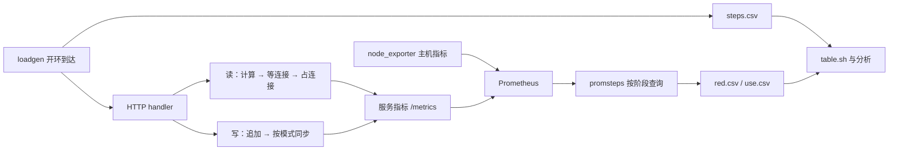

# Lab2 复现手册

本文用于第 8 组实验 2 的现场复现与答辩。实验要求见 [指导书](lab-2.html)，提交的数据和结论见 [LAB2.md](LAB2.md)。文中的历史结果来自该报告及 `runs/`；重新测量时记录新结果，并解释与历史数据的差异。

导航：[环境准备](#环境准备) · [基线测量](#基线测量) · [指标流水](#指标流水) · [读路径](#读路径) · [写路径](#写路径) · [数据分析](#数据分析) · [选做实验](#选做实验) · [现场演示](#现场演示) · [故障排查](#故障排查) · [归档收尾](#归档收尾)。

完整流程依次为：环境检查 → fsync 基线 → 指标流水线 → 读路径 → 写路径 → 数据分析 → O1、O2、O3。只做现场演示时，完成环境准备后转到[现场演示](#现场演示)。O4 按本组安排暂不做。

## 实验全貌

本实验要回答三个问题：资源最多能处理多少请求，怎样判断它已经饱和，怎样在延迟目标下确定可用容量。

| 阶段 | 做什么 | 为什么做 | 主要知识 |
|---|---|---|---|
| 任务 0 | 测主机与串行 fsync | 为后续预测建立本机基线 | CPU 时间、I/O 等待、持久化 |
| 任务 1 | 抓取指标，做低负载压测 | 测每请求 CPU 和连接占用时间 | RED、USE、Counter、Histogram、PromQL |
| R1 | 用 4 个连接逐档加压 | 观察连接池先饱和 | 容量换算、排队、尾延迟 |
| pprof | 在约 0.8 倍上限时采样 | 拆分计算和框架开销 | CPU profiling、测量窗口 |
| R2 | 扩池后再次加压 | 观察瓶颈是否转到 CPU | 瓶颈迁移、内核与运行时队列 |
| W1 | 每笔写入后 fsync | 测串行同步提交上限 | 锁、页缓存、磁盘延迟 |
| W2 | 改为组提交 | 在保留同步确认的条件下提高吞吐 | 批处理、成本摊销 |
| W3 | 每秒同步一次 | 量化延迟和持久性的取舍 | 确认语义、故障丢失窗口 |
| O1 | 对比 GOGC=100 与 400 | 观察内存和 GC 成本交换 | 堆、RSS、GC CPU、尾延迟 |
| O2 | 两台主机传输大响应 | 测实际网络路径，排除回环影响 | 带宽、重传、发送队列、协议栈 CPU |
| O3 | 用过载触发燃烧率告警 | 将请求质量转为可观测告警 | SLI、SLO、错误预算、多窗口告警 |

读请求依次执行 `spin` 计算、等待连接、占用连接并休眠 10 ms。写请求追加日志，确认时机由 `each`、`group`、`interval` 决定。“数据库”只有连接并发限制，没有真实 SQL、数据库锁或数据库 CPU。



## 环境准备

### 主机与目录

| 位置 | 用途 | 已有位置 |
|---|---|---|
| Mac | 阅读报告、传文件、提交 Git | `~/Documents/ops-lab2-8` |
| A：`se-devops` | enrolld、监控和必做压测 | 原服务工作目录 `/home/ubuntu/lab2` |
| B：`se-devops2` | O2 的负载端 | 无外网，通过 Mac 或 A 传入二进制 |

A、B 的内网地址分别为 `192.168.0.134`、`192.168.0.142`，同属一个 VPC。SSH 连接使用 Mac 上已有配置。密码和密钥不写入文档、脚本或实验输出。

截至 2026-11-03，A 上有 8080/9090/9100 和 8081/9091/9101 两套进程。原 9090 进程加载的目标与磁盘上后来修改的配置文件不同。下面从本地提交导出一份新源码，在新目录使用以下端口：

| 组件 | 本手册端口 | 原实验端口 |
|---|---|---|
| enrolld | 18080 | 8080 |
| Prometheus | 19090 | 9090 |
| node_exporter | 19100 | 9100 |

程序、参数和采集方式保持一致；端口仅用于区分实例。原来的服务与证据继续保留。不要同时运行两组压测。启动前用 `ss -H -ltn '( sport = :18080 or sport = :19090 or sport = :19100 )'` 检查端口，结果应为空；已有监听时先确认占用者。

### 准备源码

在 Mac 执行。保留这个终端，后面的文件传输继续使用其中的变量。

```bash
cd ~/Documents/ops-lab2-8
git status --short
git pull --ff-only

REPRO_TAG=$(date +%Y%m%d-%H%M%S)
REPRO_DIR="/home/ubuntu/lab2-repro-$REPRO_TAG"
B_REPRO_DIR="/home/ubuntu/lab2-client-$REPRO_TAG"

# 只导出已提交的代码、配置和工具；历史实验数据留在原仓库。
git archive HEAD Makefile go.mod cmd internal scripts deploy |
  ssh se-devops "mkdir '$REPRO_DIR' && tar -xf - -C '$REPRO_DIR'"
git rev-parse HEAD |
  ssh se-devops "cat > '$REPRO_DIR/SOURCE_REVISION'"
printf 'A 工作目录：%s\nB 工作目录：%s\n' "$REPRO_DIR" "$B_REPRO_DIR"
printf 'export REPRO_TAG="%s"\nexport REPRO_DIR="%s"\nexport B_REPRO_DIR="%s"\n' \
  "$REPRO_TAG" "$REPRO_DIR" "$B_REPRO_DIR" > /tmp/lab2-repro-session.env

ssh -t se-devops "cd '$REPRO_DIR' && exec bash"
```

新开的 Mac 终端先执行 `source /tmp/lab2-repro-session.env`，恢复这三个路径变量。最后一条会进入 A，并停在新目录。下文标注“A”的命令在这个终端执行。若本地存在未提交改动，先确认要复现哪个提交；`git archive HEAD` 不包含未提交文件。

在 A 执行：

```bash
export PATH=/home/ubuntu/apps/go/bin:$PATH
go version
for command in make python3 curl taskset vmstat mpstat iostat pidstat sar ss; do
  command -v "$command"
done

# 复用已校验的监控二进制，不改动原服务的配置。
ln -s /home/ubuntu/lab2/tools tools
make build test fmt-check vet

mkdir -p runtime runs data
sed -i 's/127.0.0.1:8080/127.0.0.1:18080/; s/127.0.0.1:9100/127.0.0.1:19100/' \
  deploy/prometheus.yml
```

若新主机缺少 sysstat，可执行 `sudo apt-get update`、`sudo apt-get install -y sysstat`。Go 需要 1.26 或更高版本；本组使用 1.26.9。若没有已有 `tools/`，在具备外网的 A 执行 `scripts/get-tools.sh`，由脚本下载并校验版本。B 不需要安装 Go。

### 公共命令

在 A 创建会话文件。它设置本次复现的目录、端口，并提供启动与停止函数。每次服务使用一个新数据目录，写实验无需删除旧日志。

```bash
cat > env.sh <<'SH'
# 本次复现的环境与进程管理；从复现目录 source 本文件。
export LAB_ROOT="$(cd "$(dirname "${BASH_SOURCE[0]}")" && pwd)"
export LAB_TAG="${LAB_ROOT##*/}"
export PATH=/home/ubuntu/apps/go/bin:$PATH
export SVC=http://127.0.0.1:18080
export PROM=http://127.0.0.1:19090
export GEN_CPUS=0
export SLO=0.05
export LC_ALL=C
export S_TIME_FORMAT=ISO
cd "$LAB_ROOT"

# 只停止本目录记录的进程，等待其退出后再允许重启。
stop_owned() {
    local name="$1" pid
    if [ ! -s "runtime/$name.pid" ]; then
        return 0
    fi
    pid=$(cat "runtime/$name.pid")
    if kill -0 "$pid" 2>/dev/null; then
        kill -TERM "$pid" || return 1
        for _ in {1..100}; do
            if ! kill -0 "$pid" 2>/dev/null; then
                break
            fi
            sleep 0.1
        done
        if kill -0 "$pid" 2>/dev/null; then
            echo "$name 尚未退出，请检查进程 $pid" >&2
            return 1
        fi
    fi
    rm -f "runtime/$name.pid"
}

# 启动独立 enrolld，保留日志并等待健康检查成功。
start_svc() {
    local name="$1"
    shift
    stop_owned enrolld || return 1
    export DATA="$LAB_ROOT/data/$name"
    if [ -e "$DATA" ]; then
        echo "$DATA 已存在，请换一个实验名" >&2
        return 1
    fi
    mkdir -p "$DATA"
    nohup env -u GOMEMLIMIT -u GODEBUG \
      GOGC="${LAB_GOGC:-100}" GOMAXPROCS="${LAB_PROCS:-1}" \
      taskset -c "${LAB_SVC_CPUS:-1}" bin/enrolld \
      -addr "${LAB_ADDR:-127.0.0.1:18080}" -data "$DATA" "$@" \
      > "runtime/$name-enrolld.log" 2>&1 < /dev/null &
    echo "$!" > runtime/enrolld.pid
    for _ in {1..50}; do
        if curl -fsS -m 1 "$SVC/healthz" >/dev/null 2>&1; then
            curl -fsS "$SVC/config"
            return 0
        fi
        sleep 0.2
    done
    cat "runtime/$name-enrolld.log" >&2
    return 1
}

# 用指定的独立 TSDB 启动 Prometheus；原 TSDB 文件不会删除。
start_prom() {
    local suffix="$1"
    stop_owned prometheus || return 1
    nohup taskset -c 0 tools/prometheus \
      --config.file=deploy/prometheus.yml \
      --storage.tsdb.path="/dev/shm/$LAB_TAG-$suffix" \
      --web.listen-address=127.0.0.1:19090 \
      --web.console.templates=deploy/consoles \
      > "runtime/prometheus-$suffix.log" 2>&1 < /dev/null &
    echo "$!" > runtime/prometheus.pid
    for _ in {1..50}; do
        if curl -fsS -m 1 "$PROM/-/ready" >/dev/null 2>&1; then
            return 0
        fi
        sleep 0.2
    done
    cat "runtime/prometheus-$suffix.log" >&2
    return 1
}

# 等待服务发现和首次抓取，确认两个目标均为 up 后再加压。
wait_targets() {
    for _ in {1..60}; do
        if curl -fsS -m 2 "$PROM/api/v1/targets" 2>/dev/null |
          python3 -c '
import json
import sys

targets = json.load(sys.stdin)["data"]["activeTargets"]
ready = (
    len(targets) == 2
    and {target["labels"]["job"] for target in targets} == {"enrolld", "node"}
    and all(target["health"] == "up" for target in targets)
)
sys.exit(0 if ready else 1)
' 2>/dev/null; then
            return 0
        fi
        sleep 1
    done
    echo "抓取目标尚未就绪，请检查 runtime/ 下的日志" >&2
    return 1
}
SH
source ./env.sh
```

后续命令默认在同一 A 终端中执行。新开 SSH 终端时，进入打印出的复现目录，重新 `source ./env.sh`。若要继续采集一个已经启动的服务，还需从 `/config` 的 `data` 字段恢复 `DATA`：

```bash
export DATA=$(curl -fsS "$SVC/config" |
  python3 -c '
import json
import sys
print(json.load(sys.stdin)["data"])
')
```

进程 PID 文件只用于当前复现会话。机器重启后重新检查进程，再启动新会话，不使用旧 PID 文件停止其他进程。

## 基线测量

### 操作目的

先测本机实际性能，再预测容量。CPU 型号不能直接推出一次请求耗时；云盘标称带宽也不能直接推出一次 fsync 延迟。

A 执行，监控和服务尚未启动时完成这一节：

```bash
mkdir -p runs/re-t0 data/re-t0
{
  date -Is
  cat /etc/os-release
  uname -r
  lscpu
  lscpu -e
  free -m
  findmnt -T data/re-t0
  lsblk -o NAME,SIZE,TYPE,ROTA,FSTYPE,MOUNTPOINTS
  go version
} > runs/re-t0/host.txt

# vmstat、iostat 第一份通常是开机以来的累计统计；比较后续间隔样本。
vmstat -w 1 12 > runs/re-t0/vmstat-idle.log &
VM_PID=$!
iostat -dx -y vda 1 11 > runs/re-t0/iostat-idle.log &
IO_PID=$!
wait "$VM_PID" "$IO_PID"

for trial in 1 2 3; do
  bin/enrolld -data data/re-t0 -bench-fsync 2000
done | tee runs/re-t0/bench-fsync-2000.txt

vmstat -t -w 1 > runs/re-t0/vmstat-fsync.log &
VM_PID=$!
iostat -dx -y -t vda 1 > runs/re-t0/iostat-fsync.log &
IO_PID=$!
bin/enrolld -data data/re-t0 -bench-fsync 5000 |
  tee runs/re-t0/bench-fsync-5000.txt
kill "$VM_PID" "$IO_PID"
wait "$VM_PID" "$IO_PID" 2>/dev/null || true
```

`vda` 是本组系统盘。换主机时，按 `findmnt` 和 `lsblk` 的结果修改。数据目录必须在块设备上；tmpfs 的 fsync 不代表真实磁盘持久化。

### 如何解释

| 指标 | 含义 | 本组负载时的典型现象 |
|---|---|---|
| `r` | 正在运行或等待 CPU 的任务数 | 不高 |
| `b` | 不可中断睡眠任务数，常见原因是 I/O | 约 1 |
| `us`、`sy` | 用户态、内核态 CPU 时间比例 | 合计约 6% |
| `wa` | 被记为 I/O 等待的 CPU 时间比例 | 约 43%～46% |
| `st` | 虚拟机未得到的宿主机 CPU 时间 | 本组样本为 0 |
| `w/s`、`wkB/s` | 写请求完成率、写入字节速率 | 约 2200 次/秒、12000 KiB/s |
| `w_await`、`f_await` | 单个写请求、flush 请求的平均响应时间 | 约 0.45、0.04 ms |
| `aqu-sz` | 平均未完成 I/O 数，包含正在处理的请求 | 约 1 |
| `%util` | 设备被记为忙碌的时间比例 | 约 94% |

本组三次 fsync 均值为 1.304、1.379、1.406 ms，平均 1.363 ms。一个写者每次同步一条记录的粗略上限为：

\[
C_{fsync}=\frac{1000}{1.363}\approx734\text{ 次/秒}
\]

这只计 fsync，完整写请求还需要 write、锁切换、HTTP 和运行时开销。单次设备请求的 await 与整个 fsync 的耗时有不同的统计边界。

### 常见追问

| 追问 | 回答要点 |
|---|---|
| CPU 很空，为什么吞吐上不去？ | 一个写者必须等待当前 fsync 完成才能继续；等待磁盘不会持续消耗 CPU。 |
| `%util=100%` 就是磁盘完全饱和吗？ | 它说明设备持续忙碌。设备可能并行处理请求，还要结合吞吐平台、队列、延迟和工作负载判断。 |
| `aqu-sz=1` 是否说明一个请求在排队？ | 它包含正在处理的请求，不能直接解释为一个纯等待请求。 |
| `ROTA=1` 能证明云盘是 HDD 吗？ | 这是虚拟块设备报告的属性，后端介质需要查实际云盘规格。 |

## 指标流水

### 启动监控

在 A 执行：

```bash
start_svc re-t1 -pool 4 -sync each
nohup taskset -c 0 tools/node_exporter \
  --web.listen-address=127.0.0.1:19100 \
  > runtime/node-exporter.log 2>&1 < /dev/null &
echo "$!" > runtime/node-exporter.pid
start_prom main

# 等待两个目标实际抓取成功。
wait_targets
curl -fsS "$PROM/api/v1/targets" |
  python3 -c '
import json
import sys
for target in json.load(sys.stdin)["data"]["activeTargets"]:
    print(target["labels"]["job"], target["scrapeUrl"], target["health"], target["lastError"])
'
```

结果应只有本次 Prometheus 的两个目标：18080 的 enrolld、19100 的 node，均为 `up`。检查实际 `scrapeUrl`，不要仅看进程是否存在。

### 低负载测量

```bash
scripts/run.sh re-t1 \
  -url "$SVC/api/courses/1" -rates 0,50,100 -step 30s -seed 1
scripts/table.sh runs/re-t1 \
  ok_rps mean_ms p99_ms server_rps server_mean_ms server_p99_ms \
  cpu_ms_per_req db_query_mean_ms

curl -fsS "$SVC/metrics" > runs/re-t1/histogram-sample.txt
curl -fsS "$PROM/api/v1/targets" > runs/re-t1/targets.json
cp deploy/queries-red.txt deploy/queries-use.txt runs/re-t1/
cp SOURCE_REVISION runs/re-t1/
```

零负载阶段用于观察空载开销。比例指标出现 `NaN` 或 `+Inf` 是零分母的结果。不能把它解释为请求有无限 CPU 成本，也不能补成 100% 达标。

`run.sh` 会生成以下证据：

| 文件 | 能回答的问题 |
|---|---|
| `meta.txt` | 用了什么参数、CPU、磁盘、请求和阶段配置？ |
| `steps.csv`、`loadgen.log` | 用户看到的吞吐、错误、延迟如何？压测端有没有失速？ |
| `red.csv` | 服务完成了多少请求，平均和尾延迟如何？ |
| `use.csv` | 哪项主机资源繁忙或有等待？ |
| `vmstat/mpstat/iostat/pidstat.log` | Prometheus 异常时，有没有独立的系统证据？ |
| `metrics-start.txt`、`metrics-end.txt` | 累计计数增加了多少，进程是否重启？ |

从源码导出的目录没有 `.git`，`meta.txt` 的提交字段会写“无”。使用保存的 `SOURCE_REVISION` 记录对应源提交。

### 查询原理

四条查询已经在 [queries-red.txt](deploy/queries-red.txt) 中实现。`${route}`、`${window}`、`${slo}` 由 promsteps 替换。在 Prometheus 输入框中查询时，先将它们替换为具体值。以读路径 25 秒窗口为例：

```promql
sum(rate(http_requests_total{route="/api/courses/{id}"}[25s]))

(sum(rate(http_requests_total{route="/api/courses/{id}",code=~"5.."}[25s])) or vector(0))
/ sum(rate(http_requests_total{route="/api/courses/{id}"}[25s]))

1000 * histogram_quantile(0.99,
  sum by (le) (rate(http_request_duration_seconds_bucket{route="/api/courses/{id}"}[25s])))

(sum(rate(http_request_duration_seconds_bucket{route="/api/courses/{id}",code="200",le="0.05"}[25s])) or vector(0))
/ sum(rate(http_requests_total{route="/api/courses/{id}"}[25s]))
```

Counter 是累计事件数，`rate()` 求单位时间内的增长速率并处理计数器重置。Gauge 是当前状态，例如池占用；对它取 `avg_over_time()`。Histogram 的 `_bucket{le="…"}` 是“耗时不超过该边界”的累计计数，`+Inf` 桶覆盖全部观测，`_sum` 是耗时总和，`_count` 是观测次数。

p99 查询先按 `le` 合并不同状态码的桶，再做桶内插值。SLI 的 50 ms 恰好是桶边界，可直接用达标桶计数除以总数，无需先算 p99。`or vector(0)` 只处理没有 5xx 或没有 good 序列的情况，分母仍保持实际请求数。

### 测量口径

| 项目 | 客户端 | 服务端 |
|---|---|---|
| 吞吐 | 成功 2xx 数 ÷ 阶段时长 | handler 完成请求计数的速率，包含失败状态 |
| 错误率 | 非 2xx、超时和网络错误 ÷ 实际发送数 | 本组查询只计 5xx 比例 |
| 延迟样本 | 只统计成功请求 | 直方图包含各状态码 |
| 计时边界 | 计划发送时刻至读完响应体 | 进入 handler 至 handler 返回 |
| 阶段归属 | 计划发送时间 | 指标记录的完成时间 |
| 统计窗口 | 完整阶段 | 去掉开头 5 秒 |

本组 T1 第 3 档的连接占用为 10.4262 ms，每请求 CPU 为 0.539766 ms。两者分别用于推算连接池与 CPU 容量。CPU 时间是进程消耗的执行时间；连接占用时间包含休眠等待，两者不能互换。

### 常见追问

| 追问 | 回答要点 |
|---|---|
| 为什么用开环？ | 到达不等待前一个请求返回，服务变慢时负载不会自动减小，能暴露积压。必须检查发送滞后。 |
| 泊松到达是什么？ | 相邻到达间隔服从指数分布，用于模拟独立用户的随机到达。目标 RPS 是期望值，每阶段实际发送量会波动。 |
| 什么是 RED、USE？ | RED 从请求看速率、错误、耗时；USE 从资源看利用率、饱和度、错误。结合两者定位请求慢在哪里。 |
| 为什么绑核？ | 减少负载端与服务端争用逻辑 CPU。两者仍共享内存带宽和缓存，虚拟机拓扑也未必等同宿主机分配。 |
| Prometheus 重启会清空数据吗？ | 单纯重启进程并复用 TSDB 路径会保留数据。主机重启会丢失 `/dev/shm`，换路径或清空目录也会失去原数据。 |

## 读路径

### 预测 R1

本组历史换算为：

\[
C_{pool}=4/0.0104262\approx384\text{ req/s},\quad
C_{CPU}=1/0.000539766\approx1853\text{ req/s}
\]

连接池先达到上限。预测应写在加压之前，包括 p99 从哪里开始超过 50 ms。预测错误可由结果解释，不能测完后改成实测值。

在 A 根据本次 T1 生成基准并保存预测：

```bash
python3 - <<'PY' > runtime/read.env
import csv
from pathlib import Path
rows = list(csv.DictReader(Path('runs/re-t1/red.csv').open()))
row = next(r for r in rows if r['target_rps'] == '100')
hold_ms = float(row['db_query_mean_ms'])
cpu_ms = float(row['cpu_ms_per_req'])
print(f'R1_BASE={round(4 * 1000 / hold_ms)}')
print(f'T1_HOLD_MS={hold_ms}')
print(f'T1_CPU_MS={cpu_ms}')
print(f'T1_CPU_CAP={round(1000 / cpu_ms)}')
PY
source runtime/read.env
{
  date -Is
  cat runtime/read.env
  printf '预测：连接池先满；p99 在约 0.75 倍池上限附近越过 50 ms。\n'
} | tee runtime/r1-prediction.txt
```

这里的 0.75 是待验证假设。若当前 T1 的 CPU 上限反而更低，应先说明环境变化，再调整实验设计。

### R1 加压

T1 服务继续运行，池大小仍为 4。

```bash
RATES=$(scripts/rates.sh "$R1_BASE")
scripts/run.sh re-r1 -url "$SVC/api/courses/1" \
  -rates "$RATES" -step 30s -seed 1
cp runtime/r1-prediction.txt runs/re-r1/
scripts/table.sh runs/re-r1 \
  ok_rps error_rate p99_ms server_mean_ms inflight_avg cpu_ms_per_req \
  pool_in_use_avg pool_wait_p99_ms sched_wait_p99_ms svc_cpu_busy
```

本组历史结果：最高成功吞吐 384.4 请求/秒；池平均占用达到 4，等待 p99 升至约 994 ms；服务核忙碌仅 20.25%。这说明连接池限制了吞吐。p99≤50 ms 的最高阶段是 311.1 请求/秒，约占预测上限的 81%。

平均利用率未到 100% 时，随机到达仍会短时占满连接，后来的请求必须排队。尾延迟因此会在吞吐上限之前上升。按 `上限×0.7` 留余量是经验起点，具体容量要由延迟目标和到达波动验证。

### CPU 剖析

在 A 执行。profile 的下载与计数读取放在同一窗口，解析 profile 在加压结束后进行。

```bash
PROFILE_RATE=$(scripts/rates.sh "$R1_BASE" 0.8)
scripts/run.sh re-profile -url "$SVC/api/courses/1" \
  -rates "$PROFILE_RATE" -step 40s -seed 1 \
  > runtime/profile-run.log 2>&1 &
RUN_PID=$!
sleep 10
curl -fsS "$SVC/metrics" > runs/re-profile/profile-start.txt
curl -fsS "$SVC/debug/pprof/profile?seconds=20" > runs/re-profile/profile.pb.gz
curl -fsS "$SVC/metrics" > runs/re-profile/profile-end.txt
wait "$RUN_PID"
go tool pprof -top -nodecount=15 bin/enrolld \
  runs/re-profile/profile.pb.gz | tee runs/re-profile/pprof-top.txt
```

用同一窗口的计数差计算每请求 CPU：

```bash
python3 - <<'PY'
from pathlib import Path
root = Path('runs/re-profile')
def read_metrics(name):
    result = {}
    for line in (root / name).read_text().splitlines():
        if line and not line.startswith('#'):
            fields = line.split()
            if len(fields) == 2:
                result[fields[0]] = float(fields[1])
    return result
start = read_metrics('profile-start.txt')
end = read_metrics('profile-end.txt')
requests = sum(value - start.get(key, 0) for key, value in end.items()
               if key.startswith('http_requests_total{route="/api/courses/{id}"'))
cpu = end['process_cpu_seconds_total'] - start['process_cpu_seconds_total']
print(f'requests={requests:.0f}, cpu_seconds={cpu:.6f}, cpu_ms_per_req={1000*cpu/requests:.6f}')
PY
```

再将每请求 CPU 乘以 `main.spin` 的 flat% 得到计算部分的估计，其余为 HTTP、JSON、系统调用、调度和内存等成本。采样比例有误差，不能当作每个请求的精确拆账。

本组 11 月 3 日的同窗口补测完成 6115 个请求，消耗 3.332097 CPU 秒，每请求 0.545 ms；spin 占 82.67%，约 0.450 ms，其余约 0.094 ms。证据见 [profile 结果](runs/r1-profile-window/profile-summary.json)。

### 预测 R2

从 R1 选负载较高、无错误、无发送警告且池尚未占满的阶段，重新估计 CPU 上限。按公式将池容量设为 CPU 上限的约两倍：

\[
C=\frac{1000}{\text{cpu\_ms\_per\_req}},\qquad
P_2=\left\lceil2C\times\frac{\text{db\_query\_mean\_ms}}{1000}\right\rceil
\]

本组使用 R1 第 6 档，得到 C≈1939、P2=41。下面自动选择候选阶段，输出后仍需对照表格检查：

```bash
python3 - <<'PY' > runtime/r2.env
import csv
import math
from pathlib import Path
root = Path('runs/re-r1')
red = {r['step']: r for r in csv.DictReader((root/'red.csv').open())}
steps = list(csv.DictReader((root/'steps.csv').open()))
candidates = [s for s in steps if s['step'] != 'all'
              and float(s['error_rate']) == 0 and not s['warn']
              and float(red[s['step']]['pool_in_use_avg']) < 3.95]
selected = max(candidates, key=lambda s: float(s['target_rps']))
row = red[selected['step']]
capacity = round(1000 / float(row['cpu_ms_per_req']))
pool = math.ceil(2 * capacity * float(row['db_query_mean_ms']) / 1000)
print(f'R2_SOURCE_STEP={selected["step"]}')
print(f'R2_C={capacity}')
print(f'R2_POOL={pool}')
PY
source runtime/r2.env
{
  date -Is
  cat runtime/r2.env
  printf '预测：扩大连接池后，CPU 先满，goroutine 调度等待上升。\n'
} | tee runtime/r2-prediction.txt
```

### R2 加压

```bash
start_svc re-r2 -pool "$R2_POOL" -sync each
RATES=$(scripts/rates.sh "$R2_C" 0.3 0.6 0.8 0.9 1.0 1.1 1.25 1.5)
scripts/run.sh re-r2 -url "$SVC/api/courses/1" \
  -rates "$RATES" -step 30s -seed 1
cp runtime/r2-prediction.txt runs/re-r2/
scripts/table.sh runs/re-r2 \
  ok_rps error_rate p99_ms cpu_cores cpu_ms_per_req cpu_wait_threads \
  sched_wait_p99_ms pool_in_use_avg svc_cpu_busy procs_running_avg cpu_psi_some
```

本组最高健康阶段为 2130.8 请求/秒，服务核忙碌约 93.75%，池等待很短。目标升至 2424 后服务核接近满载、调度等待剧增，客户端错误率约 70.6%，工具停止后续阶段。

第 7 档还有独立的测量问题：发送滞后 p99=31.91 ms；25 秒内只有三次 enrolld 抓取成功。`cpu_cores=0.128813` 不能解释为 CPU 很空。同期 `pidstat`、`mpstat` 证明服务已满载，原始结果仍保留。

复现时可在当前阶段结束时间检查抓取覆盖。下例自动取最后一个实际阶段：

```bash
END=$(python3 - <<'PY'
import csv
rows = [r for r in csv.DictReader(open('runs/re-r2/steps.csv')) if r['step'] != 'all']
print(rows[-1]['end_unix'])
PY
)
for query in \
  'avg_over_time(up{job="enrolld"}[25s])' \
  'count_over_time(process_cpu_seconds_total{job="enrolld"}[25s])'; do
  curl -fsSG "$PROM/api/v1/query" \
    --data-urlencode "query=$query" --data-urlencode "time=$END"
  printf '\n'
done
```

### 常见追问

| 追问 | 回答要点 |
|---|---|
| 为什么扩池后吞吐没有按池大小同比增加？ | 扩池只解除连接并发限制，随后由 CPU 等其他资源决定上限。 |
| `GOMAXPROCS=1` 是否只有一个线程？ | 它限制同时执行 Go 代码的线程数量，进程仍有多个 OS 线程。goroutine 可排在运行时队列中。 |
| CPU PSI 不高，能排除 CPU 饱和吗？ | PSI 观察内核任务等待，不能完整表示 Go 运行时的可运行 goroutine 队列。还需看服务核和调度延迟。 |
| 这与 Tomcat 有何相似？ | 请求可在线程池或应用队列中等待，内核运行队列无法直接表示全部应用层积压。 |
| 为什么查询占用大于 10 ms？ | 休眠到期后还要重新获得执行机会，并完成连接释放等操作。 |
| 为什么低负载预测偏低？ | 固定成本被摊薄、调度和缓存状态变化会改变单请求 CPU；本组只证实了开销随负载下降，未分别量化每个原因。 |
| 等待会“稀释”每请求 CPU 吗？ | 指标是 CPU 增量除以请求增量，等待不会直接增加分母。过载时应检查完成统计、窗口和抓取失败。 |

## 写路径

### 预测 W1

A 执行，从本次三次基线取均值：

```bash
python3 - <<'PY' > runtime/write.env
import re
from pathlib import Path
text = Path('runs/re-t0/bench-fsync-2000.txt').read_text()
means = [float(x) for x in re.findall(r'mean\s+([0-9.]+)', text)]
assert len(means) == 3
mean = sum(means) / len(means)
print(f'FSYNC_MEAN_MS={mean:.6f}')
print(f'WRITE_BASE={round(1000 / mean)}')
PY
source runtime/write.env
{
  date -Is
  cat runtime/write.env
  printf '预测：each 先受串行 fsync 限制；HTTP 和 write 会使实测低于粗略上限。\n'
} | tee runtime/w1-prediction.txt
```

在预测文件补上本次 pprof 中“非 spin CPU × 预测 TPS ÷ 1000”的核数估计。历史预测为 734×0.0915/1000≈0.067 核，实际 W1 达到约 0.130 核，说明读路径剩余成本低估了 write/fsync 开销。

### 三种模式

| 模式 | 代码行为 | 成功响应意味着什么 |
|---|---|---|
| each | 互斥锁内 write，然后 fsync | 本次记录已等到同步完成 |
| group | 后台取当前排队记录，合并 write、fsync，再通知等待者 | 所在批次已等到同步完成 |
| interval | write 后返回，后台按周期 fsync | 已写页缓存，尚可能未持久化 |

组提交没有为了攒批额外设置定时等待；当前实现每批最多 1024 条。负载增加时，在前一批同步期间到来的记录自然形成下一批。

### W1 测量

```bash
export SLO=0.02
BODY='{"student":"s{{seq}}","course":"c1"}'
WRITE_COLS=(ok_rps error_rate p99_ms server_p99_ms cpu_cores
  fsync_per_s fsync_mean_ms batch_mean svc_cpu_busy cpu_iowait
  disk_w_per_s disk_w_await_ms disk_f_per_s disk_f_await_ms disk_aqu_sz disk_util)

start_svc re-w1 -sync each
RATES=$(scripts/rates.sh "$WRITE_BASE" 0.2 0.4 0.6 0.8 0.9 1.0 1.1 1.2)
scripts/run.sh re-w1 -url "$SVC/api/enroll" -body "$BODY" \
  -rates "$RATES" -step 30s -seed 1
cp runtime/w1-prediction.txt runs/re-w1/
scripts/table.sh runs/re-w1 "${WRITE_COLS[@]}"
```

本组最大客户端成功吞吐为 729.5 TPS，服务端同期约 704 TPS。继续加压后 fsync 速率不再增加，排队和客户端超时迅速增加。单写者串行同步提交达到上限。

客户端按计划发送阶段归属请求，阶段结束后完成的成功请求也归入该阶段。服务端统计完成时间窗口，因此 729.5 和 704 的差异不能全部归因于测量误差。

### W2 测量

先查看 W1 接近上限阶段的 fsync 均值、p99，再写预测。历史上在 734 TPS 下预测成功吞吐约 734、平均批量约 1.5、p99 约 15 ms。理由是一次 fsync 期间平均到来约 `734×0.001393≈1.02` 条新记录；到达与批次边界会影响实际批量。

```bash
{
  date -Is
  printf '目标基准为 %s TPS。\n' "$WRITE_BASE"
  printf '预测：group 将减少每请求 fsync 次数，成功吞吐接近到达率，排队延迟下降。\n'
  printf '采用本组历史数据提出本轮假设：batch_mean 约 1.5，p99 约 15 ms；同步期间到来的请求会合并。\n'
} > runtime/w2-prediction.txt
# 若本次 W1 的 fsync 耗时与历史值明显不同，先调整上述两个预测值。

start_svc re-w2 -sync group
RATES=$(scripts/rates.sh "$WRITE_BASE" 0.4 0.8 1.0 1.5 2 3 4)
scripts/run.sh re-w2 -url "$SVC/api/enroll" -body "$BODY" \
  -rates "$RATES" -step 30s -seed 1
cp runtime/w2-prediction.txt runs/re-w2/
scripts/table.sh runs/re-w2 "${WRITE_COLS[@]}"
```

历史上同为 734 TPS 目标，W1 p99=1175.70 ms，W2 p99=8.72 ms，平均批量为 1.41283。W2 最高成功吞吐为 2927.5 TPS，p99=10.46 ms；这是测到的最高档，尚未达到 group 的最终上限。

### W3 测量

```bash
start_svc re-w3 -sync interval -sync-interval 1s
RATES=$(scripts/rates.sh "$WRITE_BASE" 0.4 1.5 4)
scripts/run.sh re-w3 -url "$SVC/api/enroll" -body "$BODY" \
  -rates "$RATES" -step 30s -seed 1
scripts/table.sh runs/re-w3 "${WRITE_COLS[@]}"
export SLO=0.05
```

历史最高同档下，W3 p99 为 1.92 ms，W2 为 10.46 ms；W3 每秒约一次 fsync。成功响应提前到了页缓存写入完成，机器掉电可能丢失尚未同步的已确认记录。默认周期为一秒，实际窗口还受到调度、同步耗时和同步失败影响。

### 常见追问

| 追问 | 回答要点 |
|---|---|
| group 是否牺牲持久性？ | 本实现仍等所在批次 fsync 成功后返回，合并的是同步次数。底层存储须正确履行同步语义。 |
| 为什么相同 `%util`，吞吐相差四倍？ | 同样一次 fsync 可以确认不同数量的记录。磁盘忙碌比例不等于业务吞吐。 |
| 三次 write 的 await 加两次 flush 的 await 能还原 fsync 吗？ | 不行。设备请求可能重叠，采样窗口不同，fsync 还包含文件系统处理。 |
| W3 吞吐与 W2 相近，是否上限相同？ | 两者只是都跟上了当前到达率，需要继续加压才能比较最终上限。 |
| 强制杀进程能模拟掉电吗？ | 不能。杀进程后操作系统和页缓存仍存在，内核仍可能写回数据。 |
| 选课记录选哪种？ | 本实验支持 group：同步确认、较低尾延迟、较高吞吐。interval 适合允许近期数据丢失或可可靠重放的场景。 |

## 数据分析

### 资源账

答辩时按“容量 ÷ 每请求占用”计算，并同时说明占用的单位。

| 资源 | 容量单位 | 每请求占用 | 换算 |
|---|---|---|---|
| CPU | 可用核数 | CPU 秒/请求 | 核数 ÷ CPU 秒/请求 |
| 连接池 | 连接数 | 连接占用秒/请求 | 连接数 ÷ 占用秒/请求 |
| 串行 fsync | 一个同步写者 | 秒/次同步 | 1 ÷ 同步秒数；group 再乘平均批量 |
| 网络 | bit/s | bit/响应 | 可用带宽 ÷ 响应体 bit 数，另计协议开销 |

“上限”描述资源接近饱和时的处理能力，“容量”还要满足错误率和延迟目标。R1 的 384.4 请求/秒已经有少量 503 且 p99 约一秒；50 ms 目标下只测到 311.1 请求/秒。

### 利特尔定律

\[
L=\lambda W
\]

L 是平均在途数，λ 是同一系统边界内的平均流率，W 是平均逗留时间。三个量应针对相同请求集合和稳定窗口。使用毫秒时要除以 1000。

在 A 核对本轮 R1：

```bash
python3 - <<'PY'
import csv
for row in csv.DictReader(open('runs/re-r1/red.csv')):
    if row['step'] in ('3', '6', '9'):
        predicted = float(row['server_rps']) * float(row['server_mean_ms']) / 1000
        measured = float(row['inflight_avg'])
        print(row['step'], f'lambda_W={predicted:.3f}', f'inflight={measured:.3f}',
              f'difference={(predicted/measured-1)*100:.1f}%')
PY
```

历史三个阶段为 2.759 对 2.16、7.550 对 6.52、464.608 对 463.6。小在途数、有限采样、阶段切换和速率外推会造成偏差。p99 是分布尾部的位置，无法代替平均时间 W。

### 延迟与分位数

客户端包含发送滞后、网络和内核收发、进入 handler 前的调度、读完响应体等时间。服务端计时开始后发生的调度等待仍包含在 handler 耗时中。

服务端 p99 有时更大，是因为两端样本集合、窗口不同，且直方图按桶内分布插值。R1 第 9 阶段客户端为 1012.18 ms，服务端为 1987.34 ms，宽达一秒的桶造成明显误差。W1 的 5000 ms 对应 p99 落入 +Inf 桶后的返回边界，不能当作精确尾延迟。

在 A 比较平均 p99 和总样本 p99：

```bash
python3 - <<'PY'
import csv
rows = list(csv.DictReader(open('runs/re-r1/steps.csv')))
steps = [r for r in rows if r['step'] != 'all']
combined = next(r for r in rows if r['step'] == 'all')
print('阶段 p99 的平均：', sum(float(r['p99_ms']) for r in steps) / len(steps))
print('合并样本的 p99：', combined['p99_ms'])
PY
```

历史结果为 358.47 ms 对 1011.35 ms。正确合并方法是合并原始样本再排序，或合并同桶边界、互不重叠窗口的桶计数增量后计算分位数。只剩各阶段 p99 时，无法恢复总体 p99；按请求数加权平均 p99 也不成立。

### 错误预算

本实验读 SLO 为 30 天内 99% 的请求在 50 ms 内成功。错误预算比例为 1%。

\[
\text{燃烧率}=\frac{1-\text{SLI}}{1-0.99},\qquad
\text{耗尽时间}\approx\frac{30\text{ 天}}{\text{燃烧率}}
\]

第二个公式假定后续流量水平和不良率持续不变。请求型预算取决于请求量，不能无条件当作固定的停机时长。

历史 R1 首个不达标阶段是第 6 档：客户端 SLI=0.9664，燃烧率 3.36，约 8.93 天耗尽预算；服务端 SLI=0.960663，约 3.9337 倍、7.63 天。两种口径分别计算，不能混用分子分母。

对外承诺的 SLI 应尽量靠近用户，例如入口或客户端。服务端埋点适合判断 handler 处理质量，但看不到未到达服务的请求和部分网络故障。相关原理见 [Google SRE](https://sre.google/workbook/implementing-slos/)；直方图合并见 [Prometheus](https://prometheus.io/docs/practices/histograms/)。

## 选做实验

### O1 内存

目的：在同一分配速率下，比较 GC 频次、GC CPU、RSS 与 p99。每次 `/api/report?mb=4` 分配 4 MiB，100 请求/秒对应名义分配速率 400 MiB/s；临时对象可回收，RSS 通常不会按该速率持续增长。

在 A 记录预测，再依次跑 100→400→400→100。每次启动全新服务进程，以减少前一次堆状态的影响。

```bash
{
  date -Is
  printf '预测：GOGC=400 比 100 的 GC 次数与 GC CPU 更低，RSS 更高；p99 的变化由实测判断。\n'
  printf '固定 100 req/s、60 秒、4 MiB/请求，反序再做一轮。\n'
} > runtime/o1-prediction.txt

export SLO=0.05
for item in 100-first 400-first 400-repeat 100-repeat; do
  gc=${item%%-*}
  name="re-o1-$item"
  LAB_GOGC="$gc" start_svc "$name" -sync each
  scripts/run.sh "$name" -url "$SVC/api/report?mb=4" \
    -rates 100 -step 60s -seed 1
  cp runtime/o1-prediction.txt "runs/$name/"
  cp deploy/queries-o1-gc.txt "runs/$name/"
  # O1 查询文件包含原 RED 查询，并增加 GC、RSS、heap。
  bin/promsteps -steps "runs/$name/steps.csv" -prom "$PROM" \
    -queries deploy/queries-o1-gc.txt \
    -var route=/api/report -var slo=0.05 -var cpus=1 -var disk=vda \
    > "runs/$name/red.csv"
  scripts/table.sh "runs/$name" ok_rps p99_ms gc_cycles_delta gc_cpu_delta_s rss_avg_mib
done
```

PromQL 的 `increase()` 会进行外推，覆盖去掉前 5 秒的窗口。若要与 LAB2 的 GC 增量表采用相同口径，使用起止 `/metrics` 的直接差值：

```bash
python3 - <<'PY'
import csv
from pathlib import Path

def counters(path):
    return {parts[0]: float(parts[1])
            for line in path.read_text().splitlines()
            if line and not line.startswith('#')
            for parts in [line.split()] if len(parts) == 2}

for name in ('100-first', '400-first', '400-repeat', '100-repeat'):
    root = Path('runs') / f're-o1-{name}'
    start = counters(root/'metrics-start.txt')
    end = counters(root/'metrics-end.txt')
    red = next(csv.DictReader((root/'red.csv').open()))
    step = next(csv.DictReader((root/'steps.csv').open()))
    print(name,
          'GC=', end['go_gc_cycles_total'] - start['go_gc_cycles_total'],
          'GC_CPU_s=', end['go_gc_cpu_seconds_total'] - start['go_gc_cpu_seconds_total'],
          'RSS_MiB=', red['rss_avg_mib'], 'p99_ms=', step['p99_ms'])
PY
```

历史两轮中，GC 次数减少约 75%，GC CPU 减少约 72%，RSS 从约 11 MiB 增至 25.4 MiB，p99 降低约 63%～65%。这是以更多内存换取更少回收开销，未测吞吐上限。

GOGC 调节堆增长目标，目标还受存活对象、GC roots 和内存限制影响；`GOGC=400` 不表示 RSS 必须是原来的四倍。RSS 包含进程实际驻留的多种内存，GC 回收对象后也不一定立即归还给操作系统。GC CPU 表示累计执行成本，不能当作 STW 暂停时间。与 JVM 的联系是堆空间和回收成本之间的取舍，具体回收器机制并不相同。参见 [Go GC 指南](https://go.dev/doc/gc-guide)。

### O2 网络

目的：使用真实内网传输大响应，观察吞吐平台、发送队列、重传及两端 CPU。回环压测不经过物理网络路径，无法代替此实验。

单响应 256 KiB=262144 字节。仅响应体的带宽需求为：

\[
B=r\times262144\times8\text{ bit/s}
\]

1000 请求/秒约为 2.097 Gbit/s。`sar` 的 txkB/s 以 KiB/s 表示，因此换算为 Gbit/s 时乘 1024×8，再除以 10⁹；应用成功吞吐只计算完整成功响应，接口字节计数还包含其他流量和协议处理。

#### 准备 B

在 Mac 终端执行：

```bash
source /tmp/lab2-repro-session.env
ssh se-devops2 "mkdir '$B_REPRO_DIR'"
ssh se-devops "cat '$REPRO_DIR/bin/loadgen'" > "/tmp/loadgen-$REPRO_TAG"
scp "/tmp/loadgen-$REPRO_TAG" "se-devops2:$B_REPRO_DIR/loadgen"
ssh se-devops2 "chmod +x '$B_REPRO_DIR/loadgen'; command -v sar; command -v mpstat"
```

#### 采集 A

以下脚本在 A 的复现目录创建。它只管理 18080 的实验监听与临时防火墙规则，不停止原 8080 服务。当前本组采用主机防火墙完成隔离，与指导书指定的云安全组操作不同；若现场按指导书逐项验收，应同时在云控制台核对仅 B 的内网地址获准访问实验端口，并在结束后撤销临时安全组规则。

```bash
cat > runtime/o2-server.sh <<'SH'
#!/usr/bin/env bash
# 在 A 采集网络负载，退出时关闭实验服务并撤销临时规则。
set -euo pipefail
source "$(dirname "$0")/../env.sh"
name=${1:?用法：o2-server.sh 实验名 CPU列表 GOMAXPROCS}
cpus=${2:-1}
procs=${3:-1}
run_dir="$LAB_ROOT/runs/$name"
mkdir "$run_dir"
collectors=()
chain=LAB2_REPRO
sudo -v
sudo iptables -N "$chain"

# 先停服务，再移除防火墙；保留所有实验文件。
cleanup() {
    stop_owned enrolld || true
    for pid in "${collectors[@]}"; do
        kill "$pid" 2>/dev/null || true
    done
    sudo -n iptables -D INPUT -p tcp --dport 18080 -j "$chain" 2>/dev/null || true
    sudo -n iptables -F "$chain"
    sudo -n iptables -X "$chain"
    sudo -n ip6tables -D INPUT -p tcp --dport 18080 \
      -m comment --comment lab2-repro -j REJECT --reject-with tcp-reset 2>/dev/null || true
    ss -ltn '( sport = :18080 )' > "$run_dir/listen-after.txt"
    date -Is > "$run_dir/completed.txt"
}
trap cleanup EXIT
trap 'exit 130' INT
trap 'exit 143' TERM

sudo iptables -A "$chain" -i lo -j ACCEPT
sudo iptables -A "$chain" -s 192.168.0.142/32 -j ACCEPT
sudo iptables -A "$chain" -p tcp -j REJECT --reject-with tcp-reset
sudo iptables -I INPUT 1 -p tcp --dport 18080 -j "$chain"
# 阻止双栈监听通过 IPv6 绕过上述 IPv4 来源限制。
sudo ip6tables -I INPUT 1 -p tcp --dport 18080 \
  -m comment --comment lab2-repro -j REJECT --reject-with tcp-reset
sudo iptables -S "$chain" > "$run_dir/firewall.txt"

LAB_ADDR=0.0.0.0:18080 LAB_PROCS="$procs" LAB_SVC_CPUS="$cpus" \
  start_svc "$name" -sync interval
pid=$(cat runtime/enrolld.pid)
curl -fsS "$SVC/config" > "$run_dir/config.json"
curl -fsS "$SVC/metrics" > "$run_dir/metrics-start.txt"
cp SOURCE_REVISION "$run_dir/"
date -Is > "$run_dir/started.txt"

sar -n DEV,EDEV,TCP,ETCP 1 > "$run_dir/sar.log" &
collectors+=($!)
mpstat -P ALL 1 > "$run_dir/mpstat.log" &
collectors+=($!)
pidstat -h -u -r -w -p "$pid" 1 > "$run_dir/pidstat.log" &
collectors+=($!)
(
  while true; do
    date -Is
    ss -tin '( sport = :18080 and dst 192.168.0.142 )'
    sleep 3
  done
) > "$run_dir/ss.log" &
collectors+=($!)
printf 'A 已就绪，请在 B 开始加压；完成后创建 %s/DONE\n' "$run_dir"
# 最长开放十分钟，控制端失联时也会自动收尾。
for _ in {1..600}; do
    [ ! -e "$run_dir/DONE" ] || break
    sleep 1
done
curl -fsS "$SVC/metrics" > "$run_dir/metrics-end.txt"
SH

# 先写预测，再启动等待 B 的采集进程。
{
  date -Is
  printf '预测：低档吞吐跟随到达率，约 2.1 Gbit/s 附近开始排队；同时检查两端 CPU。\n'
} > runtime/o2-prediction.txt
bash runtime/o2-server.sh re-o2 1 1
```

脚本前台等待 B 完成；这个 A 终端暂时不要输入其他命令。sudo 如需认证，在终端交互输入。

#### 加压 B

从另一个 Mac 终端连接 B，进入前面打印出的 B 工作目录。创建以下脚本；路径只需替换在 `cd` 命令中，不需要在脚本正文中修改。

```bash
# 在 Mac 执行，恢复准备阶段保存的路径。
source /tmp/lab2-repro-session.env
ssh -t se-devops2 "cd '$B_REPRO_DIR' && exec bash"
```

进入 B 后执行：

```bash
cat > run-network.sh <<'SH'
#!/usr/bin/env bash
# B 直接运行负载端，保存原始结果和本机网络、CPU 采样。
set -euo pipefail
name=${1:?用法：run-network.sh 实验名 到达率列表 阶段时长}
rates=${2:?缺少到达率}
step=${3:-30s}
mkdir "$name"
export LC_ALL=C S_TIME_FORMAT=ISO
sar -n DEV,EDEV,TCP,ETCP 1 > "$name/sar.log" &
sar_pid=$!
mpstat -P ALL 1 > "$name/mpstat.log" &
mpstat_pid=$!
trap 'kill "$sar_pid" "$mpstat_pid" 2>/dev/null || true' EXIT
curl -fsS --max-time 5 http://192.168.0.134:18080/config > "$name/config.json"
date -Is > "$name/started.txt"
env GOMAXPROCS=2 taskset -c 0,1 ./loadgen \
  -url 'http://192.168.0.134:18080/api/export?kb=256' \
  -rates "$rates" -step "$step" -seed 1 -out "$name/steps.csv" \
  > "$name/loadgen.log" 2>&1
date -Is > "$name/completed.txt"
cat "$name/loadgen.log"
SH
bash run-network.sh re-o2 100,250,400,500,700,1000,1500,2500 30s
```

B 完成后，在 Mac 通知 A 收尾并收集证据：

```bash
source /tmp/lab2-repro-session.env
ssh se-devops "touch '$REPRO_DIR/runs/re-o2/DONE'"
# A 终端返回提示符、出现 completed.txt 后再复制。
ssh se-devops "test -f '$REPRO_DIR/runs/re-o2/completed.txt'"
cd ~/Documents/ops-lab2-8
scp -r "se-devops:$REPRO_DIR/runs/re-o2" runs/
mkdir -p runs/re-o2/client
scp -r "se-devops2:$B_REPRO_DIR/re-o2/." runs/re-o2/client/
python3 scripts/summarize-network.py runs/re-o2
scripts/table.sh runs/re-o2 \
  ok_rps error_rate p99_ms a_tx_gbps a_cpu_pct b_cpu_pct retrans_per_s
```

`completed.txt` 尚不存在时，等 A 的采集脚本结束后再复制。先完成 A 的收尾，避免拷贝仍在追加的日志。`summarize-network.py` 支持原始 `ss.log` 和无损压缩的 `ss.log.gz`。

#### 双核对照

在 A 返回提示符后，先记录新预测，然后运行：

```bash
{
  date -Is
  printf '预测：扩大服务核数后若带宽平台仍相近，则单服务核不足不能单独解释原平台；关注过载时协议栈 CPU。\n'
} > runtime/o2-2cpu-prediction.txt
bash runtime/o2-server.sh re-o2-2cpu 0,1 2
```

B 执行：

```bash
bash run-network.sh re-o2-2cpu 800,1000,1200 45s
```

Mac 使用相同收尾、复制和汇总命令，将实验名全部替换为 `re-o2-2cpu`。把两份预测文件一并保存到各自结果目录。

#### 如何解释

本组首轮 700 请求/秒时 p99=8.17 ms，发送约 1.482 Gbit/s；1000 请求/秒时 p99 升至 565.86 ms，发送约 2.128 Gbit/s。继续加压后带宽平台约 2.1 Gbit/s，超时与重传增加。双核对照的 800 档 p99=8.42 ms；1000、1200 档仍出现明显排队，1200 档整机 CPU 也已接近满载。

| 追问 | 回答要点 |
|---|---|
| 为什么不用 run.sh？ | 它通过 `/config` 的 PID 在本机采集服务进程，要求 loadgen 与 enrolld 同机。O2 的客户端在 B，需分别采集。 |
| 重传是网卡故障吗？ | 重传可由丢包、拥塞、限速或接收端压力引起，应结合队列、吞吐和 CPU 判断。 |
| 2.1 Gbit/s 是 A 网卡规格吗？ | 这是当前 A→B 路径的有效发送平台。双机单向测试无法单独区分 A 出口、B 入口、云网络配额及协议栈限制。 |
| 扩到两核为什么仍会过载？ | 网络资源仍有限，更多连接和重传又增加协议栈与应用的 CPU 成本。 |
| 安全组和主机防火墙相同吗？ | 都可限制流量，作用层和管理位置不同。本组实际做了主机防火墙隔离，不能用它证明云安全组规则已配置。 |

### O3 告警

先确认所有前面实验的 CSV 已保存。为避免前面读路径过载残留在 5 分钟窗口中，本节让“本次复现的 Prometheus”使用一个新的 TSDB；原来的 TSDB 目录仍保留。

在 A 执行：

```bash
export SLO=0.05
unset LAB_ADDR LAB_PROCS LAB_SVC_CPUS LAB_GOGC
start_svc re-o3 -pool 4 -sync each
start_prom o3

tools/prometheus-3.13.4.linux-amd64/promtool check config deploy/prometheus.yml
tools/prometheus-3.13.4.linux-amd64/promtool test rules deploy/rules.test.yml
wait_targets
curl -fsS "$PROM/api/v1/rules" > runtime/o3-rules-before.json
{
  date -Is
  printf '预测：100→461→100 req/s 时，告警经历 inactive→pending→firing→inactive。\n'
  printf '规则要求 5m、1m 燃烧率都超过 14.4，持续 15 秒。\n'
} > runtime/o3-prediction.txt
```

在加压前启动告警轮询：

```bash
python3 -u - <<'PY' > runtime/o3-alerts.jsonl &
import datetime
import json
import os
import time
import urllib.request
url = os.environ['PROM'] + '/api/v1/alerts'
while True:
    with urllib.request.urlopen(url, timeout=3) as response:
        alerts = json.load(response)
    print(json.dumps({'time': datetime.datetime.now().astimezone().isoformat(),
                      'response': alerts}), flush=True)
    time.sleep(5)
PY
ALERT_PID=$!
scripts/run.sh re-o3 -url "$SVC/api/courses/1" \
  -rates 100,461,100 -step 90s -seed 1
# 留出短窗口恢复时间，再停止轮询。
sleep 60
kill "$ALERT_PID"
wait "$ALERT_PID" 2>/dev/null || true
cp runtime/o3-alerts.jsonl runtime/o3-prediction.txt runtime/o3-rules-before.json runs/re-o3/
curl -fsS "$PROM/api/v1/rules" > runs/re-o3/rules-after.json
curl -fsS "$PROM/consoles/enrolld.html" > runs/re-o3/console-after.html
```

输出状态变化：

```bash
python3 - <<'PY'
import json
previous = None
for line in open('runs/re-o3/o3-alerts.jsonl'):
    row = json.loads(line)
    states = sorted({a['state'] for a in row['response']['data']['alerts']})
    state = ','.join(states) or 'inactive'
    if state != previous:
        print(row['time'], state)
        previous = state
PY
```

若复现时 461 请求/秒不足以使当前主机过载，应依据本轮 R1 提高到达率，先记录变更原因，再用新实验名运行。不要通过修改历史结果来得到预期状态。

在 Mac 开一个新终端建立隧道：

```bash
ssh -N -L 29090:127.0.0.1:19090 se-devops
```

浏览器打开 <http://127.0.0.1:29090/consoles/enrolld.html>，告警页面为 <http://127.0.0.1:29090/alerts>。九格查询见 [看板说明](deploy/DASHBOARD.md)；其默认端口说明对应原部署，本次使用上面的隧道地址。

第一行是 RED：吞吐、5xx、p99；第二行观察 CPU、池等待、池超时；第三行是 SLI、燃烧率和 firing 告警数。逐格展开查询，说明分子、分母、窗口与单位。

#### 告警原理

不良请求同时包括失败请求和超过 50 ms 的慢请求。SLO=99%，允许不良率为 1%；当前不良率为 14.4% 时，燃烧率为 14.4 倍。若这种速率持续，30 天预算约 50 小时耗尽，一小时消耗约 2%。

规则用长窗口判断持续影响，用短窗口确认问题仍在发生，两者均超阈值并持续 15 秒才进入 firing。本实验为了缩短演示，使用 5m/1m；这些窗口不能直接等同生产的 1h/5m 组合。规则和通知是两个步骤，本实验验证 Prometheus 状态，没有部署 Alertmanager 通知链。原理参见 [SRE 告警章节](https://sre.google/workbook/alerting-on-slos/)。

| 追问 | 回答要点 |
|---|---|
| 为什么错误率很低也会告警？ | 慢 200 同样是不达标请求，预算依据好请求比例，不只看 5xx。 |
| `pending` 是什么？ | 条件已经成立，但尚未持续满足 `for: 15s`。 |
| 为什么恢复约一分钟就解除？ | 短窗口恢复后 AND 条件不成立，长窗口可以仍包含此前的不良请求。 |
| 告警解除是否预算恢复？ | 解除只说明当前条件不再满足，过去的不良事件仍计入其所属预算窗口。 |
| 没有告警就代表健康吗？ | 还需检查流量和抓取目标。当前规则不负责宕机告警，应另设 `up == 0` 等监控。 |

## 现场演示

### 时间安排

提前完成环境准备、构建和监控启动。以下时间不包括文件传输和安装依赖。老师指定某一项时，直接跳到对应阶段。

| 时间 | 演示内容 | 要说明的结论 |
|---|---|---|
| 0～2 分钟 | 查看源码版本、目标状态、分核、数据盘 | 测量对象与环境明确 |
| 2～3 分钟 | 一次 fsync 基线，展示历史三次结果 | 从耗时换算串行写上限 |
| 3～5 分钟 | R1 三档读负载 | 池等待增加，CPU 仍空闲 |
| 5～7 分钟 | R2 接近 CPU 上限的档位 | 扩池后瓶颈转移 |
| 7～10 分钟 | each/group 同档对照 | 同步保证相同，批量降低等待 |
| 10～16 分钟 | O3 的三阶段及恢复 | 错误预算转为告警状态 |
| 16～20 分钟 | 展示 O1/O2 数据，核算 Little's Law 与 p99 | 解释测量位置、成本交换和边界 |

### 演示命令

这是独立的短流程，不能与完整流程同时运行。下面使用本组历史基准，目的是快速演示已知现象；若当前主机性能变化，按实测调整。所有结果使用 `demo-` 新名字，完整流程的 `re-` 数据保留。

A 执行：

```bash
# 展示对象、核心数和数据盘。
cat SOURCE_REVISION
lscpu -e
findmnt -T data
curl -fsS "$PROM/api/v1/targets"
mkdir -p data/demo-bench
bin/enrolld -data data/demo-bench -bench-fsync 2000

# R1：健康、中间负载、过载。
export SLO=0.05
start_svc demo-r1 -pool 4 -sync each
scripts/run.sh demo-r1 -url "$SVC/api/courses/1" \
  -rates 100,307,461 -step 30s -seed 1
scripts/table.sh runs/demo-r1 \
  ok_rps error_rate p99_ms pool_in_use_avg pool_wait_p99_ms svc_cpu_busy

# R2：池扩大为 41，观察 CPU 与运行时等待。
start_svc demo-r2 -pool 41 -sync each
scripts/run.sh demo-r2 -url "$SVC/api/courses/1" \
  -rates 1939,2133,2424 -step 30s -seed 1
scripts/table.sh runs/demo-r2 \
  ok_rps error_rate p99_ms sched_wait_p99_ms pool_in_use_avg svc_cpu_busy

# 写路径：相同目标 734 TPS 下比较确认延迟。
export SLO=0.02
BODY='{"student":"s{{seq}}","course":"c1"}'
start_svc demo-each -sync each
scripts/run.sh demo-each -url "$SVC/api/enroll" -body "$BODY" \
  -rates 294,734 -step 30s -seed 1
start_svc demo-group -sync group
scripts/run.sh demo-group -url "$SVC/api/enroll" -body "$BODY" \
  -rates 294,734 -step 30s -seed 1
for name in demo-each demo-group; do
  scripts/table.sh "runs/$name" ok_rps p99_ms fsync_per_s batch_mean disk_util
done
export SLO=0.05
```

随后执行 O3 一节，使用新的 `re-o3` 名字和独立 TSDB。O3 如果已经做过，换一个服务名、run 名和 TSDB 后缀，避免重复名字及旧窗口干扰。

### 讲解顺序

面对老师指定的数据表，按以下顺序讲述：

1. 说明请求接口、参数、绑核、到达率、阶段时长和延迟目标。
2. 写出资源容量除以每请求占用的预测公式，指出预测先饱和的资源。
3. 先看成功吞吐是否跟随到达率，再看错误率和 p99。
4. 找到对应资源的利用率与等待证据，用第二种工具交叉核对。
5. 解释改动后结果如何变化，以及代价是什么。
6. 检查压测警告、抓取覆盖和计量口径，限定结论适用范围。

本组读路径的口头讲解示例：

> 低负载测得每次占连接约 10.43 ms，4 个连接对应约 384 请求/秒。R1 的吞吐在这个量级进入平台，池占满、等待上升，服务核忙碌只有约 20%，因此先限制吞吐的是连接池。扩池至 41 后，最高健康阶段达到约 2131 请求/秒，CPU 接近满载；继续加压出现运行时调度等待和错误。过载档还发生指标抓取失败，所以精确数值采用健康阶段，过载判断由系统日志交叉确认。

写路径的口头讲解示例：

> fsync 基线约 1.36 ms，因此串行 each 模式的粗略上限约 734 TPS。实测接近这个量级后延迟迅速上升。group 将同一批记录共享一次 fsync，在相同 734 TPS 到达率下，把 p99 从约 1176 ms 降到约 8.72 ms，仍然等同步完成才确认。interval 更快，但确认时数据可能只在页缓存，掉电可能丢失已确认记录。

## 故障排查

| 现象 | 先检查什么 | 处理方式 |
|---|---|---|
| SSH 能连，`go` 找不到 | `echo "$PATH"` | `export PATH=/home/ubuntu/apps/go/bin:$PATH` |
| 启动后端口被占用 | `ss -ltnp`、本目录 PID 文件 | 只停止本次复现进程；不要批量 `pkill enrolld` |
| Prometheus 抓错服务 | `/api/v1/targets` 的 scrapeUrl、`/api/v1/status/config` | 以运行时加载配置为准，修改复现目录配置后重启自己的监控 |
| `promtool` 找不到 | 解压后的工具目录 | 使用 `tools/prometheus-3.13.4.linux-amd64/promtool`，下载脚本未创建 `tools/promtool` 链接 |
| run.sh 拒绝实验名 | `runs/<名字>` 是否已存在 | 使用新名字；不要覆盖历史证据 |
| 查询返回多条序列 | 是否抓了多个实例、是否漏聚合 | 检查 job/instance 标签和 `sum by (le)` |
| `red.csv` 为空或数值突降 | `up`、抓取成功次数、采集日志 | 结合 pidstat/mpstat；不要用稀疏抓取推算精确容量 |
| 修改查询后需要重算 | 原 TSDB 是否仍可用、PROM 是否指向它 | 先复制旧 CSV，再执行 `scripts/requery.sh runs/<名字>` |
| 阶段提前停止 | `loadgen.log` 和 `-stop-below` | 成功返回不足一半时属于工具保护机制，记录实际停止档位 |
| 发送滞后警告 | `lag_p99_ms`、负载端 CPU | 本工具超过 2 ms 就告警；检查负载端资源，降低压力或单独复测 |
| CPU 警告 | `gen_cpu_pct` 与可用核数 | 100% 表示一个核；阈值是 GOMAXPROCS×100% 的 80% |
| O2 B 无法连接 | A 是否已启动、来源规则、云安全组、私网地址 | 只放通 B 到实验端口，监控端口保持回环 |
| O2 内存或日志增长 | 在途请求、`ss.log`、重传 | 保留自动停止条件，完成后发 DONE，必要时无损压缩 ss 日志 |
| O3 一开始就 pending | 当前 TSDB 是否含前一轮过载窗口 | 用新的实验 TSDB，或等待历史窗口退出后再做独立实验 |
| O3 始终不触发 | 实际负载是否超过本轮池容量、规则是否加载 | 先看 SLI、窗口流量和规则 health，再调整实验到达率 |
| 数据较历史变化 | CPU steal、并行任务、版本、参数、云盘状态 | 保留新旧结果，按同一口径解释，不要求逐位相同 |

重算查询示例，在 A 执行，且 PROM 必须指向保存了该次数据的 TSDB：

```bash
cp runs/re-r1/red.csv runs/re-r1/red-before-requery.csv
cp runs/re-r1/use.csv runs/re-r1/use-before-requery.csv
scripts/requery.sh runs/re-r1
```

`start_prom o3` 后查询的是新的 O3 TSDB。如果要重查前面的实验，先结束 O3，再执行 `start_prom main`，重新打开原复现 TSDB；不要清空其目录。

## 归档收尾

### 保存证据

在 Mac 执行，将本次新运行目录复制回来：

```bash
source /tmp/lab2-repro-session.env
cd ~/Documents/ops-lab2-8
mkdir -p "reproductions/$REPRO_TAG"
scp -r "se-devops:$REPRO_DIR/runs" "reproductions/$REPRO_TAG/"
scp -r "se-devops:$REPRO_DIR/runtime" "reproductions/$REPRO_TAG/"
scp "se-devops:$REPRO_DIR/SOURCE_REVISION" "reproductions/$REPRO_TAG/"
```

O2 的 B 侧文件按前面的方法单独收集到对应 `client/`。也可将已经在 Mac 汇总好的 `runs/re-o2*` 目录复制进本次归档。归档时检查配置、预测、版本、原始日志、CSV 和表格是否齐全。`runs/` 不应包含密码、密钥或主机公网 IP；选择性记录相关信息，不要导出整份环境变量或 SSH 配置。

### 停止进程

在 A 执行：

```bash
stop_owned enrolld
stop_owned prometheus
stop_owned node-exporter
ss -ltn '( sport = :18080 or sport = :19090 or sport = :19100 )'
```

如果 O2 脚本仍运行，先创建它的 DONE 文件或在其终端按 Ctrl-C，让清理函数退出。确认临时 INPUT 跳转、IPv4 链和 IPv6 拒绝规则都已撤销。B 的负载脚本结束后会停止自己的采集器；若中途终端断开，用 `pgrep -af 'loadgen|sar|mpstat'` 检查本次进程。

关闭 Mac 上的 SSH 隧道。现场检查结束前保留源码、二进制、TSDB 与实验输出；不要运行会删除证据的通配清理命令。

## 原理索引

答辩中解释实现时，可以打开以下文件定位具体代码，而不必凭记忆描述。

| 文件 | 关键实现 |
|---|---|
| [main.go](cmd/enrolld/main.go) | 参数默认值、路由、RED 埋点、读写 handler、大响应与内存分配接口 |
| [pool.go](cmd/enrolld/pool.go) | channel 限制连接数、获取超时、连接等待和占用的分开计时 |
| [commit.go](cmd/enrolld/commit.go) | each/group/interval 的确认顺序、1024 条批量上限、fsync 基线 |
| [procstat.go](cmd/enrolld/procstat.go) | 进程 CPU、RSS、线程等待、Go 调度和 GC 指标 |
| [metrics.go](internal/metrics/metrics.go) | Counter、Gauge、Histogram 及 Prometheus 文本输出 |
| [loadgen](cmd/loadgen/main.go) | 泊松到达、计划时间计时、阶段归属、最近秩分位数、警告和停止条件 |
| [promsteps](cmd/promsteps/main.go) | 去掉前 5 秒、在阶段结束时间查询、变量替换 |
| [run.sh](scripts/run.sh) | 配置快照、绑核、系统工具采集和阶段查询 |
| [rules.yml](deploy/rules.yml) | 双窗口燃烧率和持续时间 |

技术解释核对了以下原始资料，课程要求与本组实际数值仍以指导书、源码和 `runs/` 为准：

- [Prometheus 直方图](https://prometheus.io/docs/practices/histograms/)：桶计数、分位数误差与聚合。
- [Prometheus 查询函数](https://prometheus.io/docs/prometheus/latest/querying/functions/)：rate、increase 和 histogram_quantile。
- [Google SRE 的 SLI](https://sre.google/workbook/implementing-slos/)：用户体验、测量位置和错误预算。
- [Google SRE 的告警](https://sre.google/workbook/alerting-on-slos/)：燃烧率、多窗口与响应速度。
- [Go GC 指南](https://go.dev/doc/gc-guide)：GOGC、内存和 CPU 成本。
- [Linux PSI](https://www.kernel.org/doc/html/latest/accounting/psi.html)：some/full 压力指标与内核任务等待。
